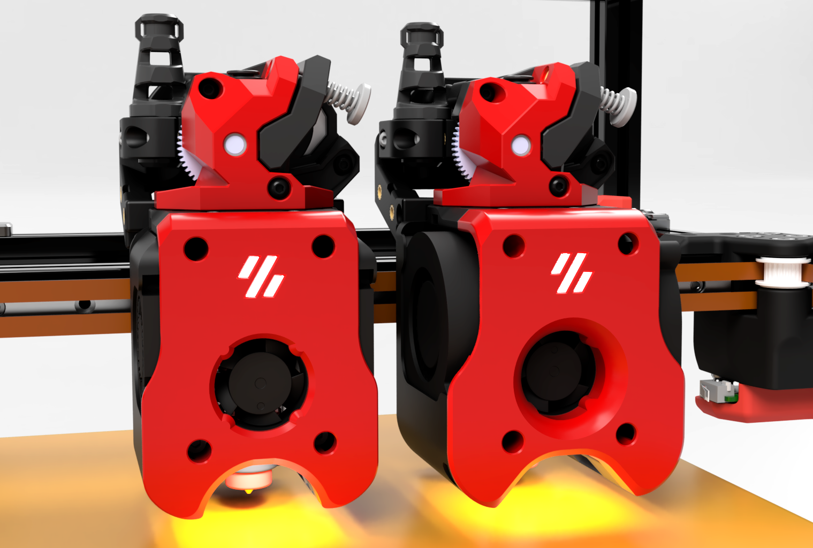

# DownDraft

DownDraft is a modular, general-purpose toolhead system for Voron Trident, V2, Legacy, and Switchwire printers. It is designed to give builders more flexibility in component choice, cleaner cable routing, and easier long-term maintenance.

The system is available in two main variants: one for 4010 part cooling fans and one for
5015 part cooling fans. Both versions support 36 mm toolhead PCB boards, with support for StealthBurner-style boards where possible. The modular mounting system allows users to choose their preferred hotend, extruder, and cooling setup without changing the core toolhead structure. Adjustable hotend fan positions also make it easier to align airflow with different heatsink heights.

DownDraft includes an integrated LED light harness, built-in strain relief, and support for both umbilical and cable chain wiring. The design also keeps serviceability in mind, with 
better access to common maintenance areas so the toolhead can be inspected, cleared, and repaired with less disassembly.

## Printer Configuration Limitations

There are some printer configurations that may need further consideration when using this toolhead:

- The dual 5015 toolhead may incur a small loss of X travel depending on the width of the front idlers

- Dual board Stealthburner toolhead PCB's are not supported using this toolhead with an X cable chain

- A v2.4 printer with an X cable chain, a toolhead PCB and the Z chain above the rear extrusion, may have some Y travel interference to the rear of the printer. Homing Y to the left of the Z chain location should resolve Y homing issues. Moving the Z chain to below the rear extrusion with a modification should also resolve any Y issues to the rear
